<p align="center">
  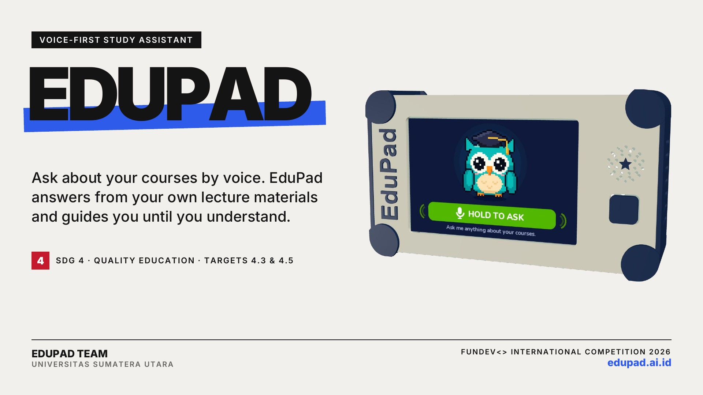
</p>

<h1 align="center">EduPad</h1>

<p align="center">
  <b>A voice-first study assistant.</b> Hold the button, ask about your courses, and EduPad answers
  from your own lecture materials, names the meeting it came from, and guides you until you understand.
</p>

<p align="center">
  <a href="https://youtu.be/Z-Z8oJeJjNA">Demo video</a> ·
  <a href="https://edupad.ai.id">edupad.ai.id</a> ·
  <a href="#system-architecture">Architecture</a> ·
  <a href="#rag-pipeline">RAG pipeline</a> ·
  <a href="#getting-started">Getting started</a> ·
  <a href="deploy/DEVICE_API.md">Device API</a>
</p>

<p align="center">
  
  
  
  
  
  
</p>

---

## Table of contents

1. [Overview](#overview)
2. [Demo](#demo)
3. [Features](#features)
4. [System architecture](#system-architecture)
5. [How a question is answered](#how-a-question-is-answered)
6. [RAG pipeline](#rag-pipeline)
7. [AI agent](#ai-agent)
8. [Database](#database)
9. [Hardware and firmware](#hardware-and-firmware)
10. [Device API](#device-api)
11. [Web dashboard](#web-dashboard)
12. [Evaluation](#evaluation)
13. [Tech stack](#tech-stack)
14. [Project structure](#project-structure)
15. [Getting started](#getting-started)
16. [CLI reference](#cli-reference)
17. [Testing](#testing)
18. [Deployment](#deployment)
19. [Privacy and security](#privacy-and-security)

---

## Overview

University enrolment has more than doubled in twenty years to **269 million students** (2024), yet
the global graduation ratio has only moved from **22% to 27%** since 2013 (UNESCO IESALC, *Higher
Education Global Trends Report 2026*). Access is growing faster than success.

Inside each course, students also fight scattered information: materials spread across meetings,
files and formats; attendance windows that close before anyone notices; deadlines in different
portals. Visually impaired students depend on portals built for the eyes.

How students use AI decides whether they learn. Students who practised with an AI that simply gave
them the answers scored **17% lower** on exams (Bastani et al., *PNAS*, 2025), while an AI tutor
designed to guide step by step **more than doubled** learning gains (Kestin et al., *Scientific
Reports*, 2025).

**EduPad follows the second model.** It is a small device and a server that:

- reads the campus portals a university already has (Moodle, the SATU academic portal and Google
  Classroom) and turns them into a searchable library for each student;
- answers spoken questions from that library only, and says which meeting the answer came from;
- notices topics a student struggles with and prepares a short lesson and a spoken quiz;
- works fully by sound in **Voice Mode**, so a student does not need to see the screen.

| SDG 4 target | How EduPad contributes |
|---|---|
| **4.3** Equal access to affordable, quality university education | A low-cost device that works on top of the LMS a campus already runs |
| **4.5** Equal access to education for persons with disabilities | Voice Mode: every answer and notification read aloud, sound cues for every state |

---

## Demo

<p align="center">
  <a href="https://youtu.be/Z-Z8oJeJjNA">
    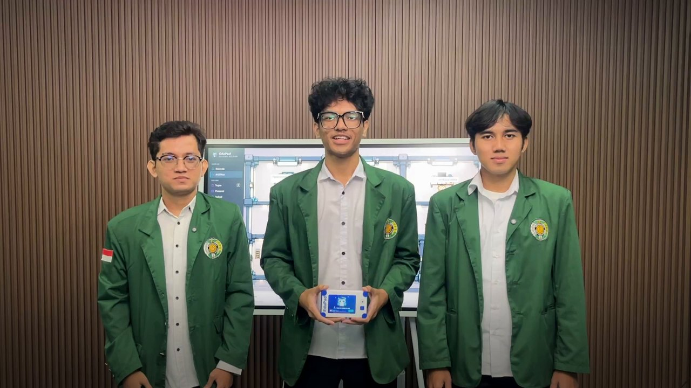
  </a>
  <br>
  <sub><b><a href="https://youtu.be/Z-Z8oJeJjNA">Watch the demo video on YouTube (4:54)</a></b>: the problem, the device, a live demo and the dashboard</sub>
</p>

<table>
  <tr>
    <td width="50%">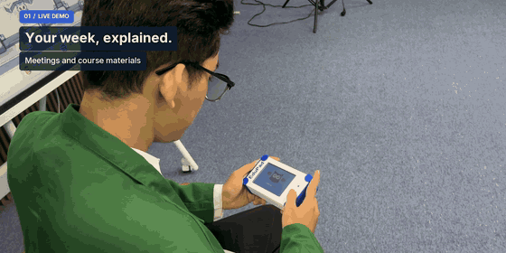</td>
    <td width="50%">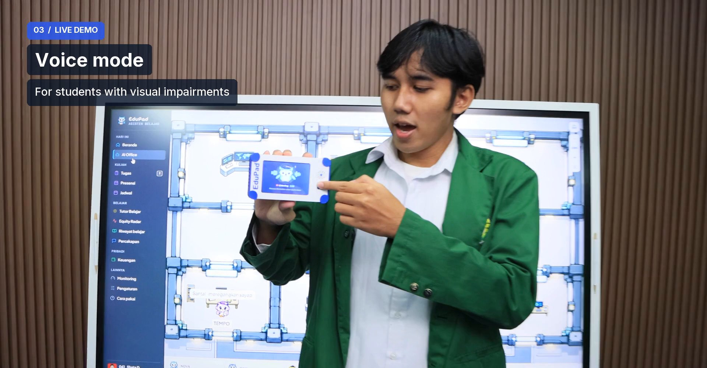</td>
  </tr>
  <tr>
    <td align="center"><sub>Asking about this week's meetings on the device</sub></td>
    <td align="center"><sub>"EduPad, turn on voice mode": the same flow without the screen</sub></td>
  </tr>
</table>

What the 4-inch screen shows while a question is answered (rendered from the firmware itself with
[`firmware/preview`](firmware/preview)):

<table>
  <tr>
    <td align="center"><br><sub>1 · Hold to ask</sub></td>
    <td align="center">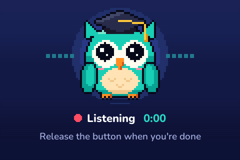<br><sub>2 · Listening</sub></td>
    <td align="center"><br><sub>3 · Searching your courses</sub></td>
    <td align="center">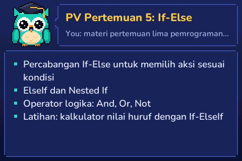<br><sub>4 · Answer with its source meeting</sub></td>
  </tr>
</table>

---

## Features

| Feature | What it does |
|---|---|
| **Ask by voice** | Ask about any course in your own words. Answers come from your lecture materials and name the meeting they came from. When the material does not cover a question, EduPad says so instead of guessing. |
| **Never miss it** | Spoken reminders before attendance closes or an assignment is due, plus a check-in confirmation on the device. In the last 24 hours before a deadline the reminder repeats every 15 minutes. |
| **Guided learning with SORA** | Finds topics you struggle with from five signals, prepares a 3-part mini lesson and 3 spoken quiz questions, then schedules reviews after 1, 3, 7, 14 and 30 days. |
| **Voice Mode** | Every answer and notification is read aloud, with a rising tone, falling tone and soft ticks for each state. Status messages are stored on the device, so they play even when Wi-Fi is down. |
| **Bilingual** | Indonesian or English, switched by saying "switch to English". Speech recognition, voice, screen labels and notifications all follow. |
| **Student finance** | "I spent twenty-five thousand on food": spending is recorded by voice and shown against monthly budgets. |
| **Web dashboard** | Seven AI owl agents in a virtual office, plus assignments, attendance, the study tutor, Equity Radar, finance and device monitoring at [edupad.ai.id](https://edupad.ai.id). |

<table>
  <tr>
    <td align="center">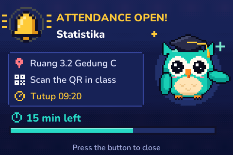<br><sub>Attendance is open</sub></td>
    <td align="center">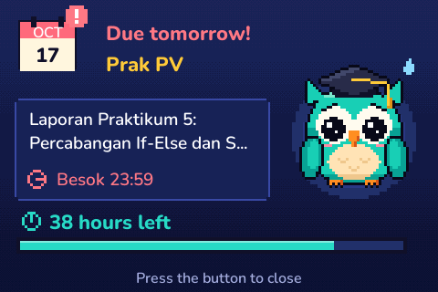<br><sub>Deadline tomorrow</sub></td>
    <td align="center">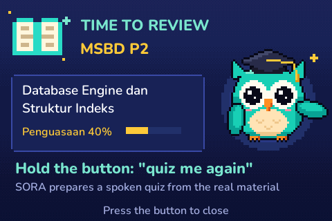<br><sub>Time to review (SORA)</sub></td>
  </tr>
</table>

---

## System architecture

<p align="center">
  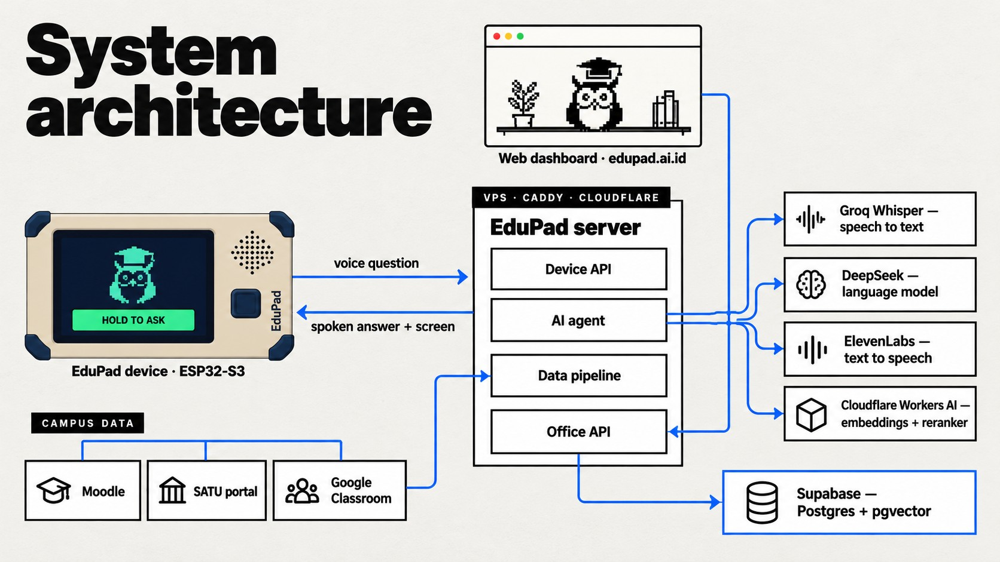
</p>

EduPad has four parts that share one data source:

| Part | Where | Role |
|---|---|---|
| **Device** | [`firmware/`](firmware) | ESP32-S3 with a microphone, speaker, 4-inch LCD and one button. Records, uploads, shows and plays. All intelligence is on the server. |
| **EduPad server** | [`src/edupad/`](src/edupad) | Python. The device API (`edupad serve`, port 8000) runs speech-to-text, the AI agent and text-to-speech. The data pipeline collects and indexes course data on a schedule. The Office API (`edupad office-api`, port 8001) serves the dashboard. |
| **AI services** | external | Groq Whisper (speech-to-text), DeepSeek (language model), ElevenLabs (voice), Cloudflare Workers AI (bge-m3 embeddings and reranker). |
| **Supabase** | [`supabase/`](supabase) | Postgres with pgvector: course chunks, conversation memory, tutor progress and finance. |

Production runs on one Ubuntu VPS behind Cloudflare and Caddy at
[edupad.ai.id](https://edupad.ai.id). The dashboard and the device read and write the same tables,
so a transaction spoken to the device appears on the dashboard immediately.

---

## How a question is answered

<p align="center">
  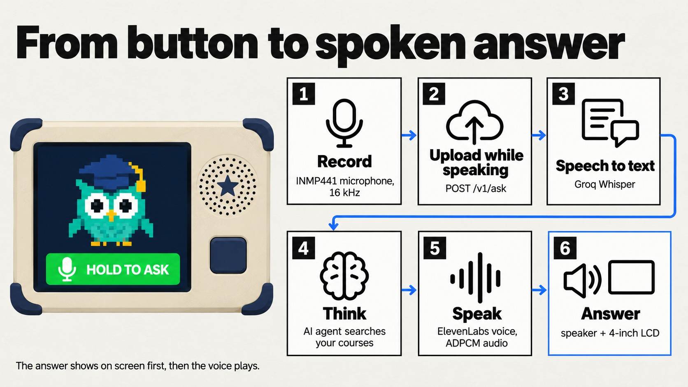
</p>

1. **Record.** While the button is held, the INMP441 microphone records 16-bit PCM at 16 kHz.
2. **Upload while speaking.** Audio streams to `POST /v1/ask` with chunked transfer encoding, so
   the upload is finished when the button is released. Silent recordings (below −35 dBFS) are
   rejected on the server and never sent to speech-to-text.
3. **Speech to text.** Groq `whisper-large-v3-turbo`, primed with course names and abbreviations
   from the catalog so "MSBD" or "PV" are spelled right.
4. **Think.** The AI agent searches the student's library and answers as JSON: `speech` (what to
   say), `screen` (title and short lines for the LCD) and `sources`.
5. **Speak.** ElevenLabs synthesises the speech; the server compresses it to IMA ADPCM (a quarter
   of the size of PCM) so the device downloads it quickly.
6. **Answer.** The LCD shows the answer first, then the voice plays through the MAX98357A amplifier.

Short button presses replay the last answer (served from storage, no TTS quota used) or start a new
conversation.

---

## RAG pipeline

<p align="center">
  
</p>

**Indexing** runs every two hours (`edupad pipeline`) and only reprocesses what changed.

| Step | Module | Detail |
|---|---|---|
| Collect | [`collectors/`](src/edupad/collectors) | Materials from Moodle (`kelas.usu.ac.id`, Playwright), assignments and deadlines, schedule and attendance from the SATU portal, classes and coursework from Google Classroom (OAuth, read-only). |
| Convert | [`processing/convert.py`](src/edupad/processing/convert.py) | PDF per page with pymupdf4llm, PPTX per slide including lecturer notes, DOCX with anydoc. Local OCR (RapidOCR) only for pages that are mostly images. Runs locally. |
| Chunk | [`processing/corpus.py`](src/edupad/processing/corpus.py) | Removes repeated headers and footers, splits into ~350-word chunks (max 550), and tags each with course, meeting, section, title and source location. A catalog maps aliases ("PV", "MSBD") to courses. |
| Summarize | [`processing/summaries.py`](src/edupad/processing/summaries.py) | One summary and topic list per meeting with DeepSeek, regenerated only when the material's hash changes. |
| Embed | [`processing/embeddings.py`](src/edupad/processing/embeddings.py) | `@cf/baai/bge-m3` (multilingual, 1024 dimensions) on Cloudflare Workers AI. The course header is embedded with the text. |
| Store | [`processing/index.py`](src/edupad/processing/index.py) | Upsert into `material_chunks`. A content hash (including the model name) means only new or changed chunks are embedded; removed chunks are deleted. |

**Answering** happens for every question:

1. **Hybrid search.** `match_material_chunks()` takes the 80 nearest chunks by cosine distance
   (pgvector) and the 80 best full-text matches (`ts_rank_cd`), fuses the two rankings with
   reciprocal rank fusion (k = 50) and returns 20 candidates, optionally filtered by course and
   meeting.
2. **Rerank.** `bge-reranker-base` scores the candidates; its ranking is fused with the hybrid
   ranking. If the reranker is unavailable, the hybrid order is used.
3. **Top 4.** The four best passages, with course and meeting, go to the agent. Passages already
   sent in this conversation are not sent again.
4. **Answer.** The agent writes the answer and must name the meeting it used. Questions such as
   "what does meeting 5 cover?" are answered from the meeting summary (`get_meeting`) instead of
   raw chunks, which saves tokens.

On the evaluation set, fusing hybrid search with the reranker put the right passage first in 14 of
17 cases (hybrid alone 13, reranker alone 12) and in the top four in 17 of 17.
Full details: [docs/rag.md](docs/rag.md).

---

## AI agent

<p align="center">
  
</p>

The agent ([`agent/assistant.py`](src/edupad/agent/assistant.py)) is a tool-calling loop on
DeepSeek (`deepseek-flash`), with up to five tool rounds per question. Its system prompt already
contains the student's course list, so simple questions need no tool call.

| Group | Tools |
|---|---|
| Course knowledge | `search_materials`, `get_meeting`, `get_classroom_materials` |
| Campus | `list_assignments`, `get_attendance`, `fill_attendance` |
| SORA tutor | `start_quiz`, `answer_quiz`, `stop_quiz`, `study_plan`, `start_help`, `continue_help`, `decline_help` |
| Finance | `record_transaction`, `finance_summary`, `set_budget`, `undo_last_transaction` |
| Device | `set_voice_mode`, `set_language` |

- **Memory.** Each conversation is a session that ends after 30 idle minutes. After 8 turns, older
  turns are summarised automatically. Lasting facts about the student are kept across sessions.
  Each turn also records the actions it performed, so a follow-up never repeats a transaction.
- **Grounded answers.** The answer must name its source meeting. If the material is not in the
  library, the agent says so; it does not answer from general knowledge as if it were course
  content.
- **Cost control.** Device mode returns speech and screen text only; long Markdown answers are
  produced only when asked. Token use and cost per question are logged to `logs/agent_usage.jsonl`.

Details on SORA, Equity Radar and finance: [docs/agent.md](docs/agent.md).

---

## Database

<p align="center">
  
</p>

| Group | Tables | Purpose |
|---|---|---|
| Course knowledge | `material_chunks`, `match_material_chunks()` | Chunks with `vector(1024)` embeddings and a `tsvector` for hybrid search, scoped by `user_id` |
| Conversation memory | `agent_sessions` → `agent_turns`, `agent_memories` | Sessions, every question and answer with its sources and actions, long-term facts |
| SORA tutor | `tutor_help` → `tutor_quizzes` → `learning_checks`, `topic_mastery` | Lessons, quizzes, graded answers and per-topic mastery with spaced-review dates |
| Finance | `finance_transactions`, `finance_budgets` | Income and spending (source: voice, dashboard or import) and monthly budgets |

Runtime files that are not in the database live in `data/` on the server (course corpus, meeting
summaries, schedule, assignments, quiz bank, device status). They are created by the pipeline and are
not committed. Every column is documented in [docs/database.md](docs/database.md); migrations are in
[`supabase/migrations/`](supabase/migrations).

---

## Hardware and firmware

<p align="center">
  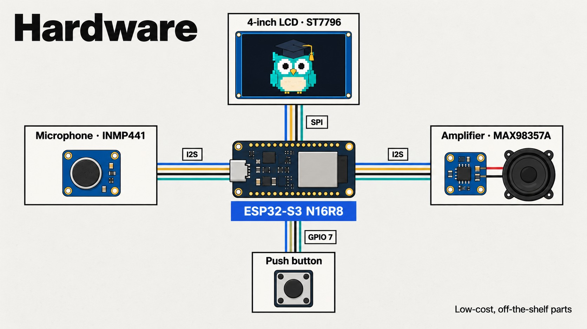
</p>

| Part | Model | Connection |
|---|---|---|
| Microcontroller | ESP32-S3 DevKitC **N16R8** (16 MB flash, 8 MB PSRAM) | Wi-Fi |
| Display | 4" SPI LCD **ST7796**, 320 × 480 | SPI: CS 10, RST 13, DC 9, MOSI 18, SCK 14, LED 21 |
| Microphone | **INMP441** I2S MEMS | I2S: SCK 4, WS 5, SD 6 |
| Amplifier + speaker | **MAX98357A** I2S, 4–8 Ω speaker | I2S: BCLK 16, LRC 17, DIN 15 |
| Button | Any push button | GPIO 7 to GND (internal pull-up) |

The firmware ([`firmware/edupad/`](firmware/edupad)) is an Arduino sketch built on LovyanGFX:

| Module | Responsibility |
|---|---|
| `app.cpp` | State machine: idle, recording, thinking, answering, notification cards, sleep |
| `mic.cpp`, `speaker.cpp`, `adpcm.cpp` | I2S recording, playback and ADPCM decoding |
| `api.cpp` | HTTPS calls to the device API with the device token |
| `scene.cpp`, `display.cpp`, `owl_sprites.h` | Animated pixel-owl screens and text layout |
| `voice.cpp` | Voice Mode: sound cues and spoken status messages cached in PSRAM |
| `wifi_setup.cpp` | Captive portal for choosing a Wi-Fi network |
| `lang.cpp` | Screen language, following the server setting |

| Button | Action |
|---|---|
| Hold | Talk; release to send |
| Press once | Replay the last answer |
| Press twice | Start a new conversation |
| Press while speaking | Stop the voice |

Wiring tables, flashing steps and troubleshooting: [firmware/README.md](firmware/README.md).
Screens can be previewed on a PC without hardware: `cd firmware/preview && make`.

---

## Device API

Every request carries `Authorization: Bearer <EDUPAD_DEVICE_TOKEN>` and device status headers
(RSSI, uptime, free heap, firmware version) that feed the monitoring page.

| Endpoint | Purpose |
|---|---|
| `POST /v1/ask` | Recorded question (raw PCM, WAV, or `{"text": ...}` for testing) → `speech`, `screen`, `audio_url`, timing |
| `GET /v1/audio/{id}`, `/v1/audio/latest` | The spoken answer as ADPCM or PCM; replay without new TTS |
| `GET /v1/updates` | Notification cards: next class, attendance open, deadlines, early warnings, reviews due |
| `GET /v1/intro`, `/v1/intro/audio` | Spoken introduction when the device starts |
| `GET /v1/speech/{key}` | A notification read aloud in Voice Mode |
| `GET /v1/voice/clip/{name}`, `/v1/voice/reply/{name}` | Status messages cached on the device; replies to voice commands |
| `GET /v1/health` | Connectivity check, no token |

Responses always include `status` and `screen`, even on errors, so the firmware has one display
path. Full contract: [deploy/DEVICE_API.md](deploy/DEVICE_API.md).

---

## Web dashboard

<table>
  <tr>
    <td colspan="2">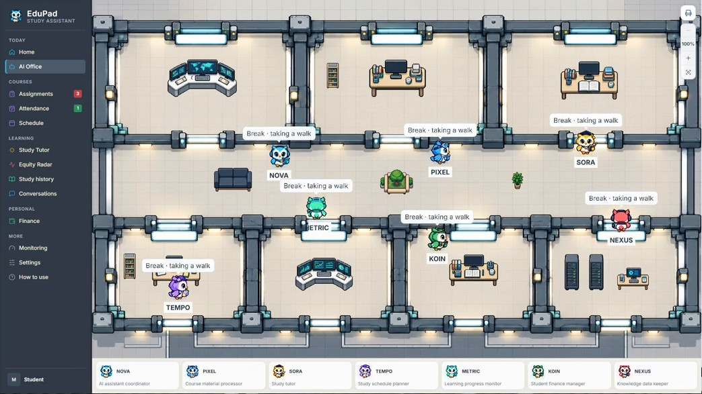</td>
  </tr>
  <tr>
    <td width="50%">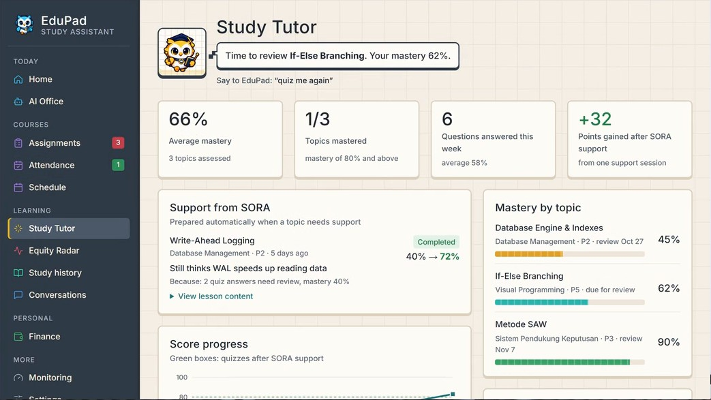<br><sub>Study Tutor: mastery by topic and SORA support</sub></td>
    <td width="50%">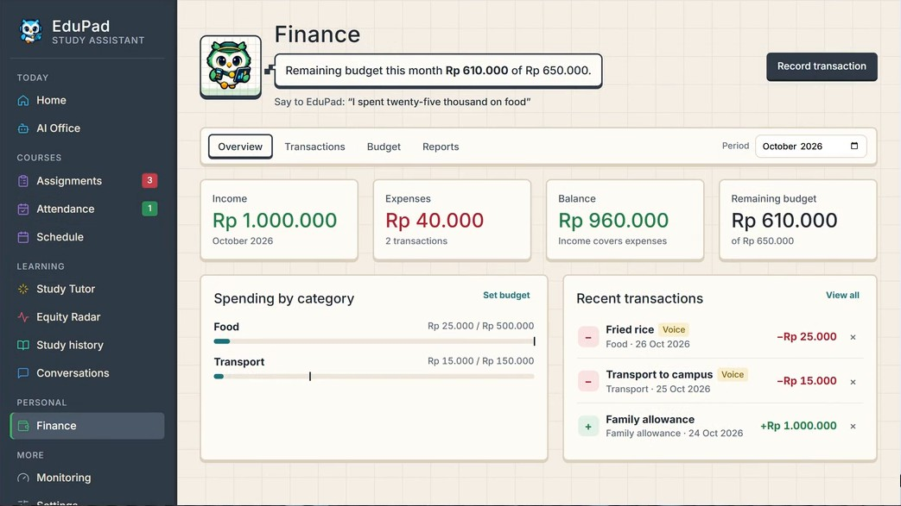<br><sub>Finance: voice-recorded spending against budgets</sub></td>
  </tr>
  <tr>
    <td width="50%">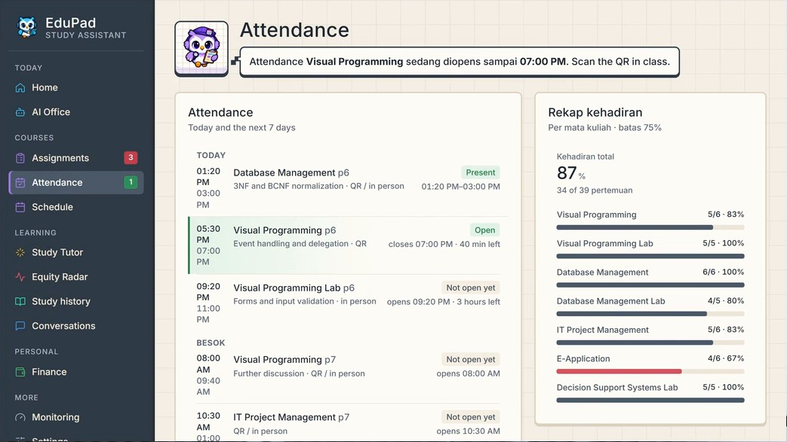<br><sub>Attendance: open windows and attendance rate per course</sub></td>
    <td width="50%">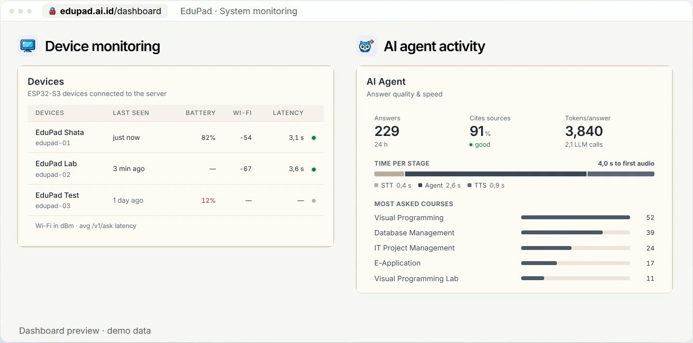<br><sub>Monitoring: devices, agent activity and latency</sub></td>
  </tr>
</table>

<sub>Screens shown with the dashboard's demo data.</sub>

The dashboard (React, TypeScript, Vite, Recharts) opens on the **AI Office**, a Phaser 2D office
where seven owl agents move according to what the AI agent is actually doing, including when the
device is asked a question.

<table>
  <tr>
    <td align="center"><br><b>NOVA</b><br><sub>Coordinates the other agents</sub></td>
    <td align="center"><br><b>PIXEL</b><br><sub>Prepares course materials</sub></td>
    <td align="center"><br><b>SORA</b><br><sub>Tutor: lessons and quizzes</sub></td>
    <td align="center"><br><b>TEMPO</b><br><sub>Plans the study schedule</sub></td>
    <td align="center"><br><b>METRIC</b><br><sub>Tracks learning progress</sub></td>
    <td align="center"><br><b>KOIN</b><br><sub>Manages student finances</sub></td>
    <td align="center"><br><b>NEXUS</b><br><sub>Keeps knowledge data in order</sub></td>
  </tr>
</table>

| Page | What it shows |
|---|---|
| Home, AI Office | Today at a glance; the live owl office |
| Assignments, Attendance, Schedule | Deadlines and submission status, open attendance windows, weekly classes |
| Study Tutor, Study history | SORA lessons with before/after scores, mastery per topic, misconceptions, learning curve |
| Equity Radar | Gaps in access to materials, attendance against the exam requirement, Voice Mode accessibility |
| Conversations | Past questions and answers with their sources |
| Finance | Transactions (voice ones are labelled), budgets and reports |
| Monitoring, Settings | Device status and agent latency; Voice Mode, speed and language |

The web front ends are in [`apps/`](apps). Each has a pixel-art version (live in production) and a
neo-brutalist version that reuses the same pages and copy with a different visual layer:

| App | Path | Dev port |
|---|---|---|
| Landing page and Google sign-in | [`apps/web`](apps/web) · [`apps/web-neo`](apps/web-neo) | 5173 · 5180 |
| Dashboard | [`apps/dashboard`](apps/dashboard) · [`apps/dashboard-neo`](apps/dashboard-neo) | 5174 · 5184 |
| AI Office game (Phaser), used by the dashboard | [`apps/ai-office`](apps/ai-office) | standalone preview |

Every dashboard request needs the owner's Google session from the landing page; only addresses in
`EDUPAD_OWNER_EMAILS` can open the data.

---

## Evaluation

EduPad was tested on 21 real questions from our own courses (23 answers including follow-ups), with
the production configuration (`evals/results/v4c-perangkat.json`, 1 October 2026):

| Metric | Result |
|---|---|
| Answers that cited the correct meeting | **100%** |
| Accuracy, scored by an LLM judge against the material | **4.96 / 5** |
| Completeness | 4.74 / 5 |
| Questions about material that is not uploaded, answered "not in your materials" | **2 of 2** |
| Average agent response time | 6.6 s |
| AI cost per answer | $0.0017 |
| Answers with a wrong detail | 1 of 23 (a date in a follow-up history question) |

Compared with the first agent, device mode cut the cost per answer by 47% and response time by 22%
with the same accuracy. Test cases are in [`evals/agent_cases.json`](evals/agent_cases.json); each
answer is checked for its source, keywords and tool use, and judged against the original material.

```bash
python -m edupad eval --label my-run
```

---

## Tech stack

| Layer | Technology |
|---|---|
| Device | ESP32-S3 N16R8, Arduino framework, LovyanGFX, I2S audio, IMA ADPCM |
| Server | Python 3.10+, `http.server` (device API), FastAPI + Uvicorn (Office API), Playwright |
| Documents | pymupdf4llm, RapidOCR (ONNX Runtime), anydoc, BeautifulSoup |
| AI | DeepSeek `deepseek-flash`, Groq `whisper-large-v3-turbo`, ElevenLabs `eleven_multilingual_v2`, Cloudflare Workers AI `bge-m3` and `bge-reranker-base` |
| Database | Supabase (Postgres, pgvector, full-text search) |
| Web | React, TypeScript, Vite, Tailwind CSS, Recharts, Phaser 3 |
| Infrastructure | Ubuntu VPS, systemd, cron, Caddy, Cloudflare |
| Quality | pytest, Ruff |

---

## Project structure

```
edupad/
├── src/edupad/              Python package (python -m edupad)
│   ├── collectors/          Moodle materials and assignments, SATU schedule and attendance, Google Classroom
│   ├── processing/          convert → corpus → summaries → embeddings → index
│   ├── agent/               agent loop, tools, memory, tutor (SORA), coach, finance, Equity Radar, eval
│   ├── voice/               speech-to-text, text-to-speech, ADPCM, Voice Mode, language, status clips
│   ├── office/              Office API for the dashboard: auth, panel data, owl events, worker
│   ├── google/              Google OAuth (PKCE) and stored accounts
│   ├── core/                sessions, Moodle and Supabase clients, HTTP pool, files, locks, notifications
│   ├── jobs/                keepalive and the scheduled pipeline
│   ├── server.py            device API (port 8000)
│   ├── webapp.py            landing page, Google sign-in, web API
│   └── cli.py               command-line entry point
├── apps/                    web front ends (React)
│   ├── web/  web-neo/       landing page, two themes
│   ├── dashboard/  dashboard-neo/   dashboard, two themes
│   └── ai-office/           Phaser AI Office used by the dashboard
├── firmware/                ESP32-S3 sketch, PC screen preview, art and tools
├── supabase/migrations/     SQL migrations
├── tests/                   pytest suite (no network, all external services faked)
├── evals/                   agent test set, results, TTS voice comparisons
├── deploy/                  Caddyfile, systemd units, crontab, server guide, device API
└── docs/                    RAG, database and agent guides; README assets
```

---

## Getting started

### Prerequisites

- Python 3.10+ and Node.js 18+
- Accounts: Supabase, DeepSeek, Groq, ElevenLabs, Cloudflare (Workers AI); Google Cloud OAuth
  client for Classroom sign-in
- A student account on the campus portals (the collectors are built for Universitas Sumatera
  Utara's Moodle and SATU portal; Google Classroom works for any campus)
- For the device: the parts listed in [Hardware](#hardware-and-firmware) and the Arduino IDE

### 1. Install

```bash
git clone https://github.com/shatahaq/edupad.git
cd edupad
python -m venv .venv && source .venv/bin/activate
pip install -e ".[dev,office]"
playwright install chromium
cp .env.example .env
```

### 2. Configure `.env`

| Variable | Used for |
|---|---|
| `API_KEY_AI` | DeepSeek, the agent and meeting summaries |
| `SUPABASE_SECRET_KEY` | Supabase secret key (`sb_secret_...`) |
| `CLOUDFLARE_ACCOUNT_ID`, `CLOUDFLARE_API_TOKEN` | Embeddings and reranker on Workers AI |
| `API_KEY_GROQ` | Speech-to-text |
| `API_KEY_ElevenLabs`, `Voice_ID_ElevenLabs` | Voice; add `...2`, `...3` for backup accounts used when a quota runs out |
| `EDUPAD_DEVICE_TOKEN` | Shared secret between the server and the firmware |
| `GOOGLE_CLIENT_ID`, `GOOGLE_CLIENT_SECRET`, `EDUPAD_PUBLIC_URL` | Google sign-in and Classroom |
| `EDUPAD_OWNER_EMAILS` | Google accounts allowed to open the dashboard |
| `TELEGRAM_BOT_TOKEN`, `TELEGRAM_CHAT_ID` | Optional alerts (expired session, attendance open) |

Every variable, with defaults and optional limits, is described in [`.env.example`](.env.example).

### 3. Set up the database

Run the files in [`supabase/migrations/`](supabase/migrations) in the Supabase SQL editor. The core
RAG and memory tables are described in [docs/database.md](docs/database.md).

### 4. Collect and index course data

```bash
python -m edupad login          # sign in to Moodle once in a browser; only the session cookie is saved
python -m edupad schedule --login
python -m edupad pipeline       # scrape → assignments → convert → corpus → summarize → index
python -m edupad ask "What does Visual Programming meeting 5 cover?"
```

### 5. Run the server and the dashboard

```bash
python -m edupad serve          # device API + landing page, http://localhost:8000
python -m edupad office-api     # dashboard API, http://localhost:8001
cd apps/web && npm ci && npm run dev                        # http://localhost:5173
cd apps/ai-office && npm ci && cd ../dashboard && npm ci && npm run dev   # http://localhost:5174/dashboard/
```

To browse the dashboard without a server, run it with demo data:
`VITE_DATA_SOURCE=mock npm run dev` in `apps/dashboard`.

### 6. Flash the device

Copy `firmware/edupad/secrets.example.h` to `secrets.h`, set the Wi-Fi, server host and device
token, then upload `firmware/edupad/edupad.ino` from the Arduino IDE. If it cannot join the Wi-Fi, the device
opens an `EduPad-Setup` hotspot to choose another network. Step-by-step instructions: [firmware/README.md](firmware/README.md).

---

## CLI reference

All commands run as `python -m edupad <command>` (or `edupad <command>` after installation). Exit
codes: `0` success, `1` error, `2` session expired and manual login needed.

| Command | Description |
|---|---|
| `login` | Sign in to Moodle (`kelas.usu.ac.id`) in a browser and save the session |
| `scrape [--course ID ...] [--list] [--headless]` | Download course materials |
| `assignments [--course ID ...]` | Assignments and quizzes with deadlines and submission status |
| `schedule [--login]` | Class schedule, attendance and enrolment from the SATU portal |
| `attendance [--fill] [--dry-run]` | Check open attendance windows; `--fill` checks in |
| `classroom [--email EMAIL]` | Google Classroom classes, coursework, materials and announcements |
| `convert [--force]` | Convert materials to Markdown |
| `corpus` | Clean and chunk the materials for the agent |
| `summarize [--force]` | Per-meeting summaries |
| `index [--force]` | Embed chunks and sync them to Supabase |
| `pipeline` | `scrape → assignments → convert → corpus → summarize → index` |
| `ask "..." [--audio file.wav] [--detail] [--trace] [--new] [--speak]` | Ask the agent from the terminal |
| `chat [--detail] [--trace] [--new] [--speak]` | Continuous conversation |
| `transcribe file.wav` | Speech-to-text only |
| `tutor-coach` | SORA: find topics that need help and prepare lessons |
| `intro` | Create the device's spoken introduction |
| `serve [--host 0.0.0.0] [--port 8000]` | Device API and landing page |
| `office-api` | Dashboard API (port 8001) |
| `office-worker` | Background worker for AI Office tasks |
| `memory [--clear]` | Show or clear the agent's memory |
| `eval --label X [--repeat N]` | Measure tokens, cost and quality on the test set |
| `keepalive` | Keep the Moodle and SATU sessions alive |

---

## Testing

```bash
python -m pytest                      # 278 tests, no network, no API quota used
python -m ruff check src tests        # lint
python -m ruff format src tests       # format (line length 100)
cd apps/dashboard && npm run build    # type-check and build a web app
```

The tests replace every external service (DeepSeek, Groq, ElevenLabs, Supabase, Google, Moodle) with
fakes from [`tests/fakes.py`](tests/fakes.py).

---

## Deployment

| Component | How it runs |
|---|---|
| Device API + landing page | `deploy/edupad-server.service` (systemd), port 8000 |
| Dashboard + Office API | `deploy/edupad-office.service` (systemd), port 8001 |
| HTTPS | Cloudflare proxy with an origin certificate, Caddy as reverse proxy ([`deploy/Caddyfile`](deploy/Caddyfile)) |
| Web apps | Built on a laptop, `dist/` copied to the server (no Node.js on the server) |

Scheduled jobs ([`deploy/crontab`](deploy/crontab), times in WIB):

| Schedule | Job |
|---|---|
| Every 10 min | `keepalive`: keep campus sessions alive |
| Every 15 min | `assignments`: submission status for deadline reminders |
| Every 2 min, 07:00–19:00 | `attendance --fill`: detect open attendance and check in |
| Every 2 h | `pipeline` (materials and index) and `classroom` |
| 05:30 daily | `schedule`: class schedule and attendance history |
| 15:30 daily | `tutor-coach`: SORA prepares help for the afternoon |

Server setup, Google OAuth, domain and HTTPS: [deploy/SERVER.md](deploy/SERVER.md).

---

## Privacy and security

- **Read-only on Moodle.** EduPad never submits, uploads or changes anything on Moodle. The only
  write to a campus service is the attendance check-in on SATU, by schedule or when the student asks.
- **No passwords stored.** Only session cookies are kept, in `user_data/` (never committed). Google
  refresh tokens are stored with `0600` permissions.
- **Local document processing.** Conversion and OCR run on the server. Only chunk text goes to
  Cloudflare (embeddings, reranking) and DeepSeek (summaries, answers); recordings go to Groq and
  answer text to ElevenLabs. Silent recordings are filtered out before any upload.
- **Per-user data.** Every table is scoped by `user_id`; each Google account gets its own space.
- **Device authentication.** Every device request needs the bearer token; the dashboard needs the
  owner's Google session.
- **Polite to campus servers.** A 2.5-second delay between requests and incremental downloads.
- **Course content stays out of git.** Lecture materials belong to their lecturers and student data
  is personal, so `data/` is generated on the server and never committed.
