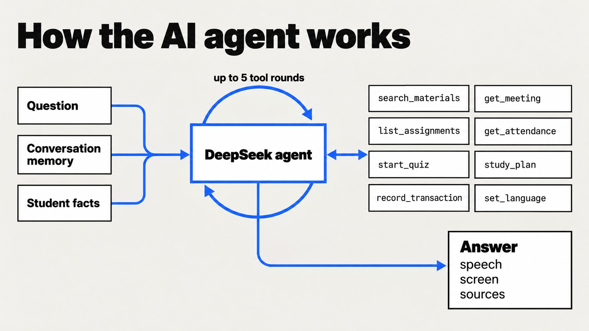

# AI agent

  

## The loop

[`agent/assistant.py`](../src/edupad/agent/assistant.py) runs one question at a time:

1. Load the conversation: the current session's recent turns, its rolling summary, and lasting
   facts about the student (`agent_memories`).
2. Build the system prompt: rules, the student's course list with aliases, lecturers and schedule
   (so "which courses do I have?" needs no tool), active quiz or help context, and the language
   rules when English is selected.
3. Call DeepSeek (`deepseek-flash`) with the tool schemas. Each tool call is executed and its result
   returned to the model, for at most five rounds (`EDUPAD_LLM_MAX_TOOL_ROUNDS`).
4. Return a structured answer: `speech` for the voice, `screen` (title and a few short lines that
   fit the 4-inch LCD), `sources`, and optionally `detail` in Markdown for the CLI.
5. Save the turn with its sources, token usage and the actions it performed.

Simple device commands ("turn on voice mode", "speak faster", "switch to English") are recognised
in [`voice/commands.py`](../src/edupad/voice/commands.py) before the model is called, so they cost
no tokens.

## Tools

| Tool | What it does |
|---|---|
| `search_materials` | Hybrid search and rerank over the student's course chunks; returns the top 4 with course and meeting ([rag.md](rag.md)) |
| `get_meeting` | Summary of one meeting, or its full text with `full=true` |
| `get_classroom_materials` | Google Classroom materials and announcements, filtered by class, keyword or meeting. Offered only when the student has Classroom data |
| `list_assignments` | Assignments from Moodle and Classroom with deadline and submission status |
| `get_attendance` | Attendance history and open windows from SATU |
| `fill_attendance` | Checks in to an open attendance window when the student asks |
| `start_quiz`, `answer_quiz`, `stop_quiz` | Spoken quiz from a meeting's real material |
| `study_plan` | What to study today, from mastery, reviews due and deadlines |
| `start_help`, `continue_help`, `decline_help` | SORA's prepared lesson, part by part |
| `record_transaction`, `undo_last_transaction` | Record or undo an expense or income by voice |
| `finance_summary`, `set_budget` | Remaining budget, spending by category, monthly budgets |
| `set_voice_mode`, `set_language` | Device settings |

## Memory

| Layer | Storage | Rule |
|---|---|---|
| Session | `agent_sessions` | A new session starts after 30 idle minutes or when the button is pressed twice |
| Turns | `agent_turns` | When 8 turns have not been summarised, older ones are folded into the session summary |
| Facts | `agent_memories` | Lasting facts ("struggles with recursion") kept across sessions |
| Actions | `agent_turns.actions` | Data changes already made, so "and add the bus fare too" never records lunch twice |

`python -m edupad memory` shows what the agent remembers; `--clear` deletes it.

## SORA, the study tutor

[`agent/tutor.py`](../src/edupad/agent/tutor.py) and [`agent/coach.py`](../src/edupad/agent/coach.py)
implement an adaptive learning loop:

1. **Detect.** For each topic (course + meeting) SORA counts five signals: wrong or partial quiz
   answers, low mastery, missed reviews, repeated questions to the device, and the student saying
   they do not understand. A topic needs help when at least two kinds of signal appear. Attendance
   is deliberately not a signal.
2. **Analyse.** `python -m edupad tutor-coach` runs every afternoon (15:30 WIB), picks one or two
   topics and records the difficulty as an agent memory.
3. **Help.** It prepares a 3-part spoken mini lesson aimed at the misconception, plus targeted quiz
   questions, stored in `tutor_help`. The help is offered on an afternoon card on the device and when
   the student next talks to EduPad.
4. **Measure.** Mastery is recorded before and after the help and shown on the dashboard.

Quizzes are generated from the meeting's material and kept in a question bank
(`data/tutor/bank.json`), so the next quiz starts without waiting for the model. Mastery below 0.6
counts as weak, 0.8 and above as mastered. Each quiz scored 0.8 or higher moves the topic to the next
review interval: 1, 3, 7, 14, then 30 days.

## Equity Radar

[`agent/radar.py`](../src/edupad/agent/radar.py) computes one set of signals for three places: the
spoken study plan, the dashboard's Equity Radar page and the device's notification cards.

- **Learning:** mastery per topic from spoken quizzes.
- **Access to materials:** meetings that already took place (from SATU attendance) compared with
  the material available on Moodle or Classroom, how much came from OCR, and which meetings have a
  summary that can be read aloud.
- **Early warnings:** attendance close to the minimum for the final exam
  (`EDUPAD_MIN_ATTENDANCE`, default 75%), deadlines, and budgets running out.

## Finance

[`agent/finance.py`](../src/edupad/agent/finance.py) is shared by the device and the dashboard.
"Tadi beli makan dua puluh lima ribu" ("I just spent twenty-five thousand on food") becomes a
`record_transaction` call with amount 25,000, category `Makan` and source `suara` (voice), which the
dashboard labels. "Hapus yang tadi" ("delete that") undoes it. Expense categories match the
dashboard's: food, transport, housing, tuition, internet, health, entertainment and other.

## Evaluation

[`agent/evaluate.py`](../src/edupad/agent/evaluate.py) replays
[`evals/agent_cases.json`](../evals/agent_cases.json) (21 cases, including follow-ups and material
that does not exist) and scores each answer on:

- the source meeting, expected keywords and the tools used;
- whether it admits missing material;
- accuracy and completeness, judged by an LLM against the original material, plus a hallucination
  flag.

Results are stored in [`evals/results/`](../evals/results); `v4c-perangkat.json` is the production
configuration reported in the README.
