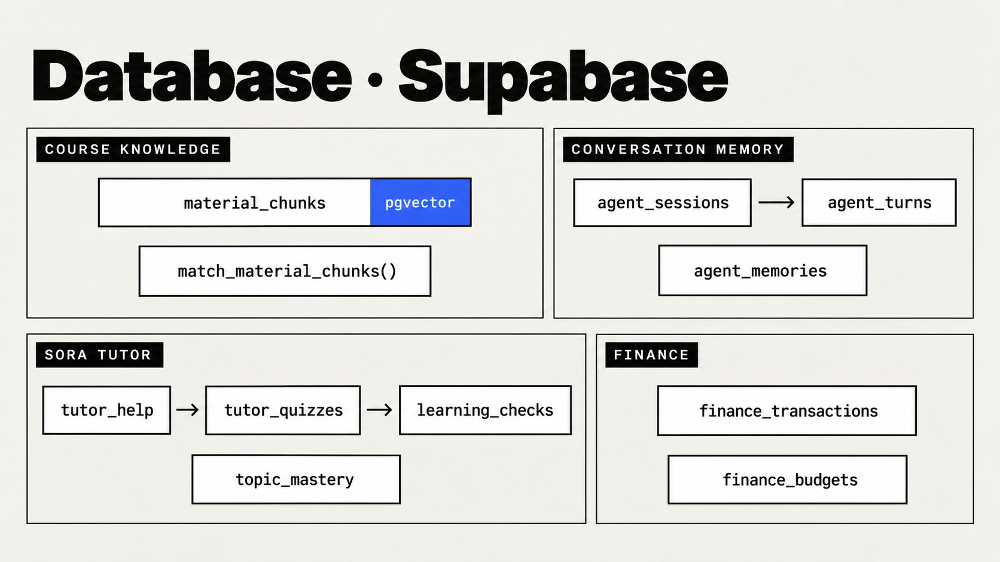

# Database

EduPad stores everything that the device and the dashboard share in **Supabase** (Postgres with the
`pgvector` extension). The server talks to it through the PostgREST API with a secret key
([`core/supabase.py`](../src/edupad/core/supabase.py)). The migrations enable row level security
without public policies, so only the server's secret key can read or write those tables.

<p align="center">
  
</p>

## Tables at a glance

| Group | Table | One row is | Written by |
|---|---|---|---|
| Course knowledge | `material_chunks` | One ~350-word chunk of course material with its embedding | `edupad index` |
| Conversation memory | `agent_sessions` | One conversation (ends after 30 idle minutes), with a rolling summary | Agent |
| | `agent_turns` | One question and answer: speech, screen, sources, token usage, actions taken | Agent |
| | `agent_memories` | One lasting fact about the student, used across sessions | Agent |
| SORA tutor | `tutor_help` | One prepared help session: problem, reasons, 3-part lesson, questions, before/after mastery | `edupad tutor-coach` |
| | `tutor_quizzes` | One spoken quiz and its progress | `start_quiz` |
| | `learning_checks` | One graded answer, with feedback and any misconception | `answer_quiz` |
| | `topic_mastery` | Mastery of one topic (course + meeting) and its next review date | Tutor |
| Finance | `finance_transactions` | One income or expense, from voice, the dashboard or an import | Agent, dashboard |
| | `finance_budgets` | Monthly budget per category | Agent, dashboard |

Every table has a `user_id`. The device and CLI use the owner's id; each other Google account gets
its own id (`google-<id>`), so data never mixes.

## Hybrid search function

`match_material_chunks` runs inside Postgres, so one round trip returns the fused ranking:

1. **Filter** the student's chunks (`user_id`), and optionally a course (also matching chunks shared
   with parallel classes through `also_in`) and a meeting.
2. **Semantic:** the `match_count × 4` nearest chunks by cosine distance (`<=>`) on `embedding`.
3. **Keyword:** the `match_count × 4` best full-text matches on `fts`, ranked with `ts_rank_cd`.
   The `simple` configuration is used, so Indonesian and English terms and code identifiers are
   matched as written, without stemming.
4. **Fuse** both lists with reciprocal rank fusion: `1 / (rrf_k + semantic_rank) + 1 / (rrf_k +
   keyword_rank)`, with `rrf_k = 50`. A chunk found by only one branch still scores.

EduPad calls it with `match_count = 20` and reranks the result (see
[rag.md](rag.md#rerank-and-fuse)).

```sql
create or replace function public.match_material_chunks(
  query_embedding vector,
  query_text text,
  p_user_id text,
  match_count integer default 6,
  p_course_id text default null,
  p_meeting integer default null,
  rrf_k integer default 50
)
returns table (
  id text, course_id text, course_name text, meetings integer[], section text, title text,
  location text, is_ocr boolean, source_url text, content text,
  similarity double precision, score double precision
)
language sql
stable
set search_path to 'public', 'extensions'
as $function$
  with filtered as (
    select c.*
    from material_chunks c
    where c.user_id = p_user_id
      and (p_course_id is null or c.course_id = p_course_id or p_course_id = any (c.also_in))
      and (p_meeting is null or p_meeting = any (c.meetings))
  ),
  semantic as (
    select f.id,
           1 - (f.embedding <=> query_embedding) as similarity,
           row_number() over (order by f.embedding <=> query_embedding) as rank
    from filtered f
    order by f.embedding <=> query_embedding
    limit match_count * 4
  ),
  keyword as (
    select f.id,
           row_number() over (order by ts_rank_cd(f.fts, to_tsquery('simple', query_text)) desc) as rank
    from filtered f
    where coalesce(query_text, '') <> '' and f.fts @@ to_tsquery('simple', query_text)
    limit match_count * 4
  )
  select f.id, f.course_id, f.course_name, f.meetings, f.section, f.title, f.location, f.is_ocr,
         f.source_url, f.content,
         coalesce(s.similarity, 1 - (f.embedding <=> query_embedding)) as similarity,
         coalesce(1.0 / (rrf_k + s.rank), 0) + coalesce(1.0 / (rrf_k + k.rank), 0) as score
  from semantic s
  full outer join keyword k on k.id = s.id
  join filtered f on f.id = coalesce(s.id, k.id)
  order by score desc
  limit match_count;
$function$;
```

## Columns

Generated from the live schema.

#### `material_chunks`

| Column | Type | Notes |
|---|---|---|
| `user_id` | text | primary key |
| `id` | text | primary key |
| `course_id` | text |  |
| `course_name` | text |  |
| `course_code` | text | nullable |
| `meetings` | int[] |  |
| `section` | text | nullable |
| `title` | text | nullable |
| `kind` | text | nullable |
| `location` | text | nullable |
| `is_ocr` | boolean | default `false` |
| `source_file` | text | nullable |
| `source_url` | text | nullable |
| `also_in` | text[] |  |
| `word_count` | int32 | nullable |
| `content` | text |  |
| `content_hash` | text |  |
| `embedding_model` | text |  |
| `embedding` | vector(1024) |  |
| `fts` | tsvector | nullable |
| `updated_at` | timestamptz | default `now()` |

#### `agent_sessions`

| Column | Type | Notes |
|---|---|---|
| `id` | uuid | primary key, default `gen_random_uuid()` |
| `user_id` | text |  |
| `started_at` | timestamptz | default `now()` |
| `last_active` | timestamptz | default `now()` |
| `summary` | text | nullable |
| `summarized_until` | int64 | default `0` |

#### `agent_turns`

| Column | Type | Notes |
|---|---|---|
| `id` | int64 | primary key |
| `session_id` | uuid | → `agent_sessions.id` |
| `user_id` | text |  |
| `created_at` | timestamptz | default `now()` |
| `question` | text |  |
| `speech` | text |  |
| `screen` | jsonb |  |
| `detail` | text | nullable |
| `sources` | jsonb |  |
| `usage` | jsonb | nullable |
| `actions` | jsonb |  |

#### `agent_memories`

| Column | Type | Notes |
|---|---|---|
| `id` | int64 | primary key |
| `user_id` | text |  |
| `content` | text |  |
| `created_at` | timestamptz | default `now()` |

#### `tutor_help`

| Column | Type | Notes |
|---|---|---|
| `id` | uuid | primary key, default `gen_random_uuid()` |
| `user_id` | text |  |
| `topic_key` | text |  |
| `course` | text |  |
| `course_id` | text | nullable |
| `meeting` | int32 | nullable |
| `title` | text | default `''` |
| `problem` | text | default `''` |
| `reasons` | jsonb |  |
| `lesson` | jsonb |  |
| `questions` | jsonb |  |
| `status` | text | default `siap` |
| `part` | int32 | default `0` |
| `mastery_before` | real | nullable |
| `mastery_after` | real | nullable |
| `created_at` | timestamptz | default `now()` |
| `started_at` | timestamptz | nullable |
| `finished_at` | timestamptz | nullable |
| `declined_at` | timestamptz | nullable |

#### `tutor_quizzes`

| Column | Type | Notes |
|---|---|---|
| `id` | uuid | primary key, default `gen_random_uuid()` |
| `user_id` | text |  |
| `course` | text |  |
| `course_id` | text | nullable |
| `meeting` | int32 | nullable |
| `title` | text | default `''` |
| `questions` | jsonb |  |
| `current` | int32 | default `0` |
| `status` | text | default `active` |
| `created_at` | timestamptz | default `now()` |
| `updated_at` | timestamptz | default `now()` |
| `help_id` | uuid | → `tutor_help.id`, nullable |

#### `learning_checks`

| Column | Type | Notes |
|---|---|---|
| `id` | int64 | primary key |
| `user_id` | text |  |
| `quiz_id` | uuid | → `tutor_quizzes.id`, nullable |
| `topic_key` | text |  |
| `course` | text |  |
| `course_id` | text | nullable |
| `meeting` | int32 | nullable |
| `question` | text |  |
| `expected` | text | default `''` |
| `answer` | text | default `''` |
| `verdict` | text |  |
| `score` | real |  |
| `feedback` | text | default `''` |
| `misconception` | text | nullable |
| `created_at` | timestamptz | default `now()` |

#### `topic_mastery`

| Column | Type | Notes |
|---|---|---|
| `user_id` | text | primary key |
| `topic_key` | text | primary key |
| `course` | text |  |
| `course_id` | text | nullable |
| `meeting` | int32 | nullable |
| `title` | text | default `''` |
| `mastery` | real |  |
| `attempts` | int32 | default `0` |
| `last_score` | real | nullable |
| `last_checked_at` | timestamptz | nullable |
| `next_review_at` | timestamptz | nullable |
| `interval_days` | int32 | nullable |

#### `finance_transactions`

| Column | Type | Notes |
|---|---|---|
| `id` | uuid | primary key, default `gen_random_uuid()` |
| `user_id` | text |  |
| `kind` | text |  |
| `amount` | int64 |  |
| `category` | text |  |
| `note` | text | default `''` |
| `occurred_on` | date | default `((now() AT TIME ZONE 'Asia/Jakarta'::text))` |
| `source` | text | default `dashboard` |
| `created_at` | timestamptz | default `now()` |

#### `finance_budgets`

| Column | Type | Notes |
|---|---|---|
| `user_id` | text | primary key |
| `category` | text | primary key |
| `amount` | int64 |  |
| `updated_at` | timestamptz | default `now()` |

## Migrations

| File | Adds |
|---|---|
| [`20261013_edu_pad_office.sql`](../supabase/migrations/20261013_edu_pad_office.sql) | `office_tasks`, `office_agent_events` for the AI Office (optional; the default store is a local file, `EDUPAD_OFFICE_STORAGE=local`) |
| [`20261017_finance_tutor.sql`](../supabase/migrations/20261017_finance_tutor.sql) | Finance and tutor tables |
| [`20261018_tutor_help.sql`](../supabase/migrations/20261018_tutor_help.sql) | `tutor_help` and the link from quizzes to help sessions |
| [`20261023_turn_actions.sql`](../supabase/migrations/20261023_turn_actions.sql) | `agent_turns.actions`, so follow-up turns never repeat a data change |

Run them once in the Supabase SQL editor, in order. The course knowledge and conversation memory
tables (`material_chunks`, `match_material_chunks`, `agent_sessions`, `agent_turns`,
`agent_memories`) were created directly in the SQL editor before migrations were introduced; their
columns are listed above.

## Files on the server

Data that is read far more often than it changes stays as files in `data/` (never committed):

| Path | Content |
|---|---|
| `data/materials/`, `data/markdown/` | Downloaded course files and their Markdown conversion |
| `data/corpus/` | `catalog.json`, per-meeting Markdown, `chunks.jsonl`, `summaries.json` |
| `data/assignments/`, `data/schedule/` | Assignments with status, schedule, attendance |
| `data/classroom/` | Google Classroom data per account |
| `data/tutor/bank.json` | Quiz questions per meeting, so the next quiz starts instantly |
| `data/voice/` | Device introduction and Voice Mode status clips |
| `data/device/` | Last device status and language setting |
| `data/office/` | AI Office state when stored locally |
