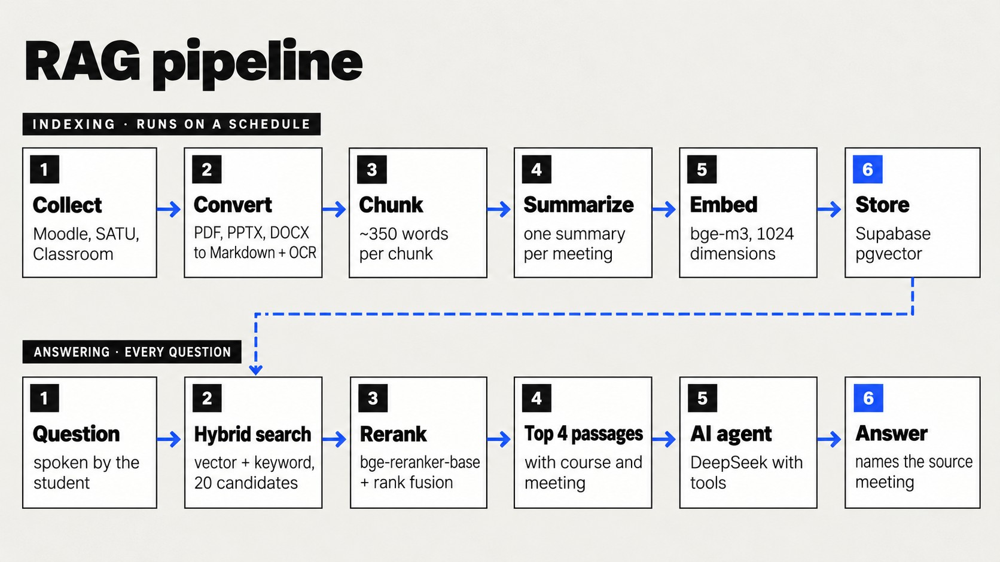

# RAG pipeline

EduPad answers only from a student's own course materials. This page explains how those materials
become a searchable library and how a question is matched to the right passage.

<p align="center">
  
</p>

## Indexing

`python -m edupad pipeline` runs every two hours on the server and chains six steps. Every step is
incremental: unchanged files are skipped, so a run with no new material takes seconds.

### 1. Collect

| Source | Module | What is collected |
|---|---|---|
| Moodle (`kelas.usu.ac.id`) | [`collectors/materials.py`](../src/edupad/collectors/materials.py) | Course files and pages per meeting, through Playwright with the saved SSO session |
| Moodle | [`collectors/assignments.py`](../src/edupad/collectors/assignments.py) | Assignments and quizzes: deadline, submission status, instructions and attachments |
| SATU academic portal | [`collectors/schedule.py`](../src/edupad/collectors/schedule.py), [`attendance.py`](../src/edupad/collectors/attendance.py) | Enrolled classes (KRS), weekly schedule, attendance history, open attendance windows |
| Google Classroom | [`collectors/classroom.py`](../src/edupad/collectors/classroom.py) | Classes, coursework with status, materials and announcements (read-only OAuth scope) |

The collectors only read. A 2.5-second delay between requests keeps the load on campus servers low.

### 2. Convert

[`processing/convert.py`](../src/edupad/processing/convert.py) turns every file into Markdown with
metadata, entirely on the server:

- **PDF**: pymupdf4llm page by page. Pages that are mostly an image with little text (under 200
  characters, image over 15% of the page) go through local OCR (RapidOCR).
- **PPTX**: read slide by slide from the XML, including the lecturer's notes.
- **DOCX and others**: anydoc.

anydoc is not used for PDF and PPTX because it reorders slide text into pseudo-tables and loses page
and slide boundaries, which the chunker needs. Each PDF is converted in its own child process, and
progress is resumable.

### 3. Chunk

[`processing/corpus.py`](../src/edupad/processing/corpus.py) produces `data/corpus/`:

| File | Content | Used by |
|---|---|---|
| `catalog.json` | Enrolled courses, aliases ("PV", "MSBD"), lecturers, schedule, list of meetings | Matching course names, the agent's system prompt |
| `meetings/<course_id>/pNN.md` | All material of one meeting | `get_meeting` |
| `chunks.jsonl` | ~350-word chunks with metadata and source location | Embedding |

Rules:

- Lines that appear on at least half of the pages or slides of a file are treated as headers or
  footers and removed (only for files with four or more segments).
- Pages and slides are grouped into chunks of about 350 words; anything over 550 words is split,
  and fragments under 15 words (a title slide, an empty page) are dropped.
- Every chunk carries course, meeting(s), section, title, kind, page or slide location, whether it
  came from OCR, the source file and URL, and other places the same content appears.
- The text that is embedded starts with a short header (course, meeting, title), so a chunk about
  "normalization" is found for "MSBD meeting 3" as well.

### 4. Summarize

[`processing/summaries.py`](../src/edupad/processing/summaries.py) asks DeepSeek for one summary and
topic list per meeting and stores them in `data/corpus/summaries.json`. A summary is regenerated
only when the hash of that meeting's material changes.

### 5. Embed

[`processing/embeddings.py`](../src/edupad/processing/embeddings.py) calls Cloudflare Workers AI:

| Model | Use |
|---|---|
| `@cf/baai/bge-m3` | Multilingual embeddings, 1024 dimensions, batches of 32 |
| `@cf/baai/bge-reranker-base` | Relevance scores at question time |

DeepSeek has no embedding API, and bge-m3 handles Indonesian and English in the same vector space.

### 6. Store

[`processing/index.py`](../src/edupad/processing/index.py) upserts chunks into the Supabase table
`material_chunks` (see [database.md](database.md)). The content hash includes the model name:

- unchanged chunks are not embedded again;
- changing the embedding model re-embeds everything automatically;
- chunks that disappeared from the corpus are deleted.

## Answering

### Hybrid search

`search_materials` in [`agent/tools.py`](../src/edupad/agent/tools.py) embeds the question and
calls the Postgres function `match_material_chunks` with:

| Argument | Value |
|---|---|
| `query_embedding` | bge-m3 vector of the question |
| `query_text` | Question keywords joined with `|`, Indonesian stop words removed |
| `p_user_id` | The student's data space |
| `p_course_id`, `p_meeting` | Optional filters when the student named a course or meeting |
| `match_count` | 20 candidates |

The function ranks chunks by vector similarity (pgvector) and by full-text match (`tsvector`) and
fuses both rankings with reciprocal rank fusion (`rrf_k`). Keyword search catches exact terms such as
function names or acronyms that embeddings can blur; vector search catches paraphrases.

### Rerank and fuse

The 20 candidates (title plus the first 1,500 characters) are scored by `bge-reranker-base`. The
reranker order is then fused with the hybrid order:

```
score(i) = 1 / (30 + hybrid_rank(i)) + 2.0 / (30 + rerank_rank(i))
```

If the reranker call fails, the hybrid order is used as is, so an outage never blocks an answer.

| Configuration (17 retrieval cases) | Correct passage ranked 1st | In the top 4 |
|---|---|---|
| Hybrid search only | 13 | 16 |
| Reranker only | 12 | not measured |
| **Hybrid + reranker, fused** | **14** | **17** |

### Generation

The top four passages, each with course and meeting, are returned to the agent. Passages already
sent earlier in the conversation are not sent again. The agent must name the meeting it used; when
nothing relevant is found it tells the student that the topic is not in their materials.

For questions about a whole meeting ("what does meeting 5 cover?"), `get_meeting` returns the
meeting summary instead of raw chunks, and the full text only when the student asks for detail.

## Running it

```bash
python -m edupad pipeline          # everything, incremental
python -m edupad convert --force   # rebuild Markdown
python -m edupad index --force     # re-embed every chunk
python -m edupad ask "Kenapa B+ tree dipakai untuk index database?" --trace
```

`--trace` prints every tool call and the passages returned, which is the quickest way to see why
the agent chose a source.
